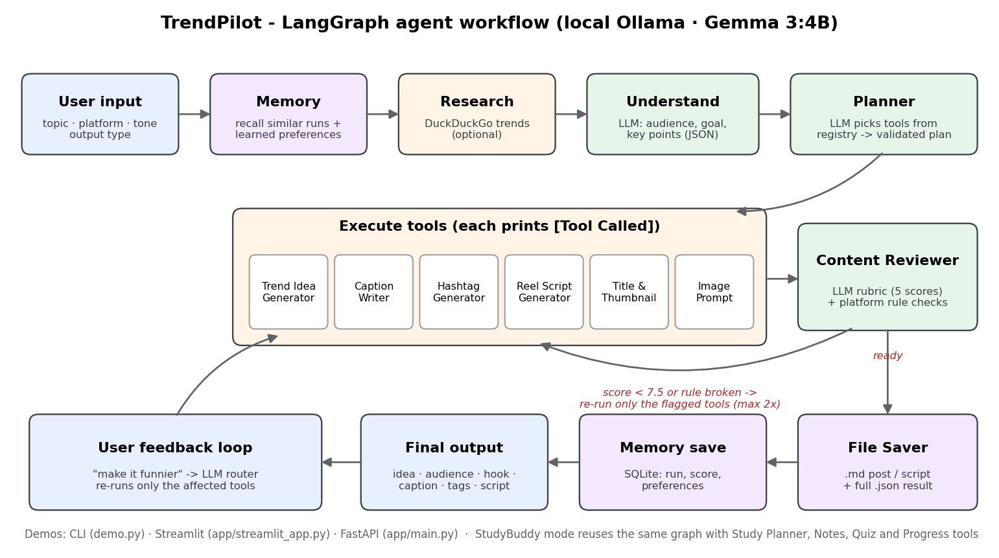
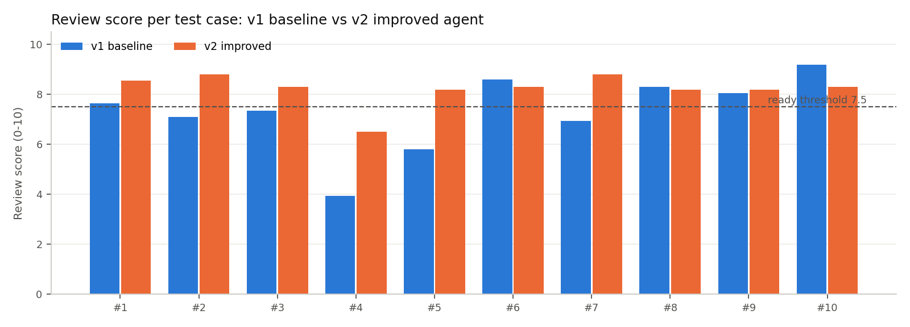

# 🚀 TrendPilot - Local Agentic AI Content Planner (+ StudyBuddy mode)

**AIRI Team PITB - AI Internship Task 2 · by Hamza Nadeem**

TrendPilot is an end-to-end **AI agent running fully locally** on **Gemma 3:4B through Ollama** (no paid API).
Give it a topic, a platform and a tone - it **understands** the request, **plans** which tools it needs, **calls** them,
**reviews its own output** against platform rules, **rewrites the weak parts**, **saves** the result and **remembers** it.
The same engine also runs **StudyBuddy**, a study-plan agent with notes, quizzes and progress tracking.

> Example: *"I want to create a viral LinkedIn post about my YOLOv8 helmet detection project"* →
> content idea, target audience, hook, LinkedIn caption, hashtags, 30-45 s reel script, title + thumbnail text,
> review score and a saved Markdown file.



## Why this is an agent, not a chatbot

| Simple chatbot | TrendPilot |
|---|---|
| One prompt → one answer | Understands goal + audience, then an **LLM planner** picks tools from a registry (plan is validated) |
| No tools | 10 content tools + 5 StudyBuddy tools, each printing `[Tool Called]: <name>` |
| No quality control | **Content Reviewer** = LLM rubric (5 scores) + deterministic platform rules → **automatic rewrite loop** (max 2) |
| Forgets everything | **SQLite memory**: past runs, learned preferences, study progress - recalled before every run |
| Text on screen | **Markdown + JSON files** saved automatically · CLI, Streamlit and FastAPI demos |

## Results (10 test cases from the brief, real Gemma 3:4B runs)

<!-- RESULTS:START -->
| Metric | v1 baseline | v2 final agent |
|---|---|---|
| Average review score (0-10) | 7.29 | **8.21** |
| Platform-rule violations (10 tests) | 15 | **2** |
| Directly usable outputs | 3/10 | **9/10** |

Model: `gemma3:4b` on Tesla T4, 15360 MiB - avg 36.5 s per request - 17 saved Markdown outputs. Full table: [tests/test_cases.md](tests/test_cases.md).


<!-- RESULTS:END -->

**v1** = baseline (simple prompts, fixed pipeline, no review loop) · **v2** = final agent.
Details: [tests/test_cases.md](tests/test_cases.md) · Report: [report/final_report.pdf](report/final_report.pdf) ·
LinkedIn write-up: [report/linkedin_portfolio_report.md](report/linkedin_portfolio_report.md)

## Tools

| Tool | What it does |
|---|---|
| Simple Memory Tool | Recalls similar past topics, hooks and preferences (SQLite) so content stays fresh |
| Web Trend Research | Optional DuckDuckGo search for current angles (skipped automatically when offline) |
| Trend Idea Generator | 5 content angles with a score; picks the best one + target audience |
| Caption Writer | Platform-specific caption: hook first, word/character limits, CTA, no invented numbers |
| Hashtag Generator | Right number of hashtags per platform, broad + niche, spam tags removed |
| Reel Script Generator | 15-60 s script with timestamps, visuals, voice-over and closing line |
| Title & Thumbnail Generator | Catchy titles (≤60 chars) and thumbnail text (≤5 words) |
| Post Image Prompt Generator | Prompt for a cover image (full content plans) |
| Content Reviewer | Scores hook, clarity, platform fit, tone, engagement + rule checks → tells the agent what to rewrite |
| File Saver Tool | Saves `.md` post/script + full `.json` result |
| StudyBuddy: Study Planner, Notes, Quiz, Reviewer, Progress Saver | Day-by-day plan, notes, MCQ quiz, progress in SQLite |

## Run it on Google Colab (recommended)

1. Upload `agentic_ai_task_2.zip` to **My Drive**.
2. Open `notebooks/TrendPilot_Colab.ipynb` in Colab → **Runtime → Change runtime type → T4 GPU**.
3. **Runtime → Run all**. The notebook installs Ollama, pulls `gemma3:4b`, runs the demos, the 10 test cases (v1 and v2),
   makes the screenshots and builds `report/final_report.pdf`. Results are copied back to `My Drive/agentic_ai_task_2/`.

## Run it locally

```bash
# 1. Install Ollama (https://ollama.com/download) and the model
ollama pull gemma3:4b
ollama run gemma3:4b "Give me 5 viral LinkedIn post ideas about AI internships."

# 2. Python packages
pip install -r requirements.txt

# 3a. CLI demo (interactive)
python demo.py
#     or non-interactive
python demo.py --topic "YOLOv8 helmet detection project" --platform LinkedIn --tone "Professional but exciting" --output "Post + Reel Script"
python demo.py --mode study --topic "object detection" --days 7 --level Beginner

# 3b. Streamlit demo
streamlit run app/streamlit_app.py

# 3c. FastAPI demo  ->  http://localhost:8000/docs
uvicorn app.main:app --port 8000
```

FastAPI example:

```bash
curl -X POST http://localhost:8000/generate-content -H "Content-Type: application/json" \
  -d '{"topic": "YOLOv8 helmet detection project", "platform": "LinkedIn", "tone": "professional and exciting", "output_type": "post and reel script"}'
```

Settings (environment variables): `TRENDPILOT_MODEL` (default `gemma3:4b`), `OLLAMA_HOST_URL`, `TRENDPILOT_PROMPT_VERSION`
(`v1`/`v2`), `TRENDPILOT_WEB_SEARCH` (`0` to disable), `TRENDPILOT_REVIEW_THRESHOLD` (default 7.5).

## Project structure

```
agentic_ai_task_2/
├── app/
│   ├── main.py            FastAPI backend
│   ├── agent.py           LangGraph agent: memory → research → understand → plan → execute → review ⟲ refine → save
│   ├── tools.py           tool registry + all tools + Markdown renderers
│   ├── memory.py          SQLite long-term memory (runs, preferences, study progress)
│   ├── prompts.py         v1 baseline + v2 improved prompts, JSON schemas, platform rules
│   ├── llm.py             Ollama client: structured JSON outputs, retries, model fallback, call stats
│   ├── quality.py         deterministic platform-rule checks used by the reviewer
│   ├── evaluation.py      10 test cases, v1 vs v2 comparison, error analysis
│   ├── config.py          settings (env overridable)
│   └── streamlit_app.py   Streamlit demo
├── outputs/  generated_posts/ · generated_scripts/ · saved_results/ · study_plans/ · logs/
├── tests/    test_cases.md · mock_ollama.py (offline test server)
├── screenshots/  ollama_running.png · demo_output.png · saved_file_output.png · architecture.png
├── report/   final_report.pdf · linkedin_portfolio_report.md
├── notebooks/TrendPilot_Colab.ipynb
├── scripts/  build_report.py · screens.py · build_notebook.py
├── README.md · requirements.txt · demo.py
```

## Engineering notes

- **Reliable JSON from a 4B model**: every tool sends a JSON schema in Ollama's `format` field; on a parse/validation error the
  error is fed back to the model and it retries, then falls back to `format: "json"`.
- **Self-correction**: the reviewer combines an LLM rubric with hard rules (X/Twitter 280 chars, hashtag counts, script
  length, clichés, invented metrics). Only the tools responsible for a problem are re-run.
- **Plan validation**: the LLM's plan is checked - unknown tools removed, required tools added, order fixed.
- **Graceful degradation**: model fallback (llama3.2:3b, qwen2.5:3b, phi3:mini), web search optional, a failing tool never
  crashes the run, LangGraph optional (plain loop fallback).
- **Observability**: every run is logged to `outputs/logs/agent_runs.jsonl` (tools, score, LLM calls, tokens, time).

## Tech stack

Python · Ollama · Gemma 3:4B · LangGraph · Streamlit · FastAPI · SQLite · DuckDuckGo search · fpdf2 · Google Colab (T4)

---
Built by **Hamza Nadeem** for the AIRI Team PITB AI Internship.
